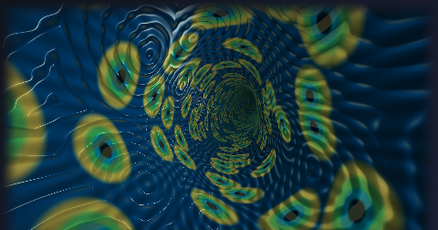
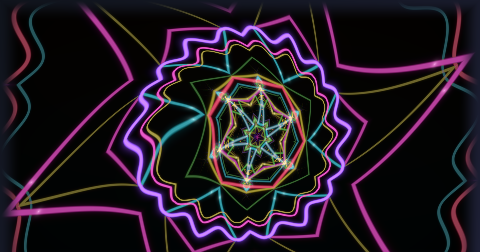
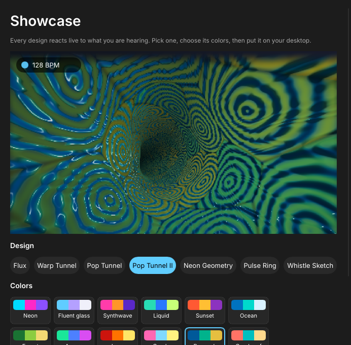

<p align="center"></p>

<p align="center">Beat-locked GPU visualizers for the Windows desktop, written in Rust.</p>

<p align="center">
  
  
  
  
</p>

> **Alpha.** Expect rough edges; please file [issues](https://github.com/lahirukas/vizz/issues).

## Features

- **Real-time beat tracking**: tempo, beat phase, bar position and next-beat prediction from a
  pure-Rust analysis pipeline (FFT, spectral-flux onsets, comb-filter tempo, dynamic-programming beat
  tracker). Visuals settle within ~0.3 s when music stops.
- **Any source**: WASAPI loopback (whatever is playing, including Bluetooth) or microphone.
- **Designs**: Warp Tunnel, Pop Tunnel, Pop Tunnel II, Neon Geometry, Flux, Pulse Ring, and
  Whistle Sketch (steer an arrow by whistling: pitch turns it, a double whistle explodes it).
- **Desktop widgets**: embedded in the desktop layer behind icons, always on top, or floating.
  16 palettes, 4 quality levels, live in-app previews.
- **Lightweight**: ~25 MB RAM; rendering pauses on silence and while fullscreen apps run.

<p align="center"></p>

## Install

Download `vizz-<version>-windows-x64.zip` from [Releases](https://github.com/lahirukas/vizz/releases),
unzip, run `vizz.exe`. Portable; no admin rights. Requires Windows 10 1903+ / 11 (x64) and a
Direct3D 11 GPU (feature level 10.0+). Settings are stored in `%APPDATA%\Vizz`.

## Build

Requires Rust (`x86_64-pc-windows-msvc`), Visual Studio Build Tools (C++ workload) and the Windows
SDK (`fxc.exe`, `rc.exe`).

```powershell
cargo build --release
.\target\release\vizz.exe --source loopback   # or: mic, wav:<file>
```

Other flags: `--background`, `--edit`, `--console`, `--exit-after <s>`.

| Crate | Role |
| --- | --- |
| `crates/dsp` | Audio analysis and beat tracking (no platform dependencies) |
| `crates/audio` | WASAPI capture: loopback, microphone, per-process |
| `crates/render` | Direct3D 11 + DirectComposition renderer, HLSL shaders (SM 4.0) |
| `crates/app` | Win32 shell: tray, widgets, Slint settings UI |

Design notes live in [`docs/dev`](docs/dev); release signing is described in
[`docs/CODE_SIGNING.md`](docs/CODE_SIGNING.md).

## License

[GPL-3.0-or-later](LICENSE). The settings UI uses [Slint](https://slint.dev) under the GPL-3.0.
